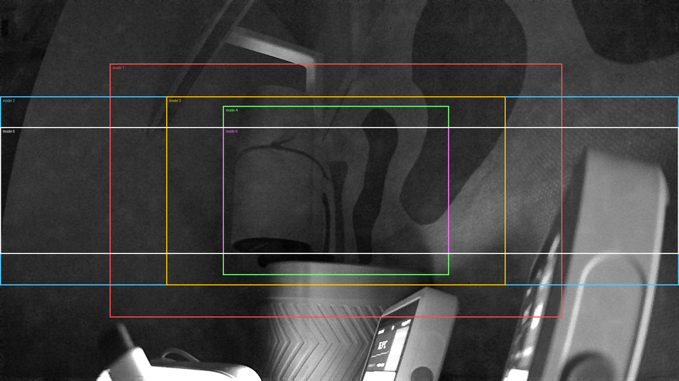

# Field of view (Phase 6)

Status: crop placement and fractions **measured [HW]**. The lens angle itself
isn't measured yet (it needs a target at a known distance). Angles below are
**[CALC]** for assumed lenses.

## Capture procedure

1. Fix the camera on a mount and keep it fixed for every mode. Aim it at a
   wall with a measured grid (for example tape marks every 10 cm), at a measured
   distance `d`.
2. For each `sensor_mode`, load the module with that mode (see
   [README.md](README.md)) and save one frame: `lgcap -n 5 -f <working fps> -s <SD>/mode<N>`.
   `tools/lgmodes.sh` does the load-and-capture step per mode.
3. Measure the lens: in the mode 0 image, read off the visible wall width `Ww`
   and height `Wh`. Then HFOV = 2·atan(Ww / 2d) and VFOV = 2·atan(Wh / 2d).
   Repeat this per mode to confirm the crop fractions below.

## Measured crop placement **[HW]**

A sweep captured one frame per mode back to back, from a fixed position. Mode
0 was taken at the start and again at the end, with matching content. Each
mode's frame was then located inside the 1080p frame by normalised
cross-correlation (`tools/fovmatch.py`):

| Mode | Frame | Found at (x, y) in 1080p | Predicted | Correlation | H × V fraction of the 1080p FOV |
|---|---|---|---|---|---|
| 1 | 1280×720 | (310, 180) | (320, 180) | 0.952 | 0.667 × 0.667 |
| 2 | 1920×536 | (0, 273) | (0, 270) | 0.979 | **1.000** × 0.496 |
| 3 | 960×536 | (470, 273) | (480, 270) | 0.914 | 0.500 × 0.496 |
| 4 | 640×480 | (630, 300) | (640, 300) | 0.908 | 0.333 × 0.444 |
| 5 | 640×360 | (630, 360) | (640, 360) | 0.929 | 0.333 × 0.333 |
| 6 | 1920×360 | (0, 360) | (0, 360) | 0.977 | **1.000** × 0.333 |

- **Every mode is a pure 1:1 crop** of the 1080p frame, with no scaling, at the
  position the window formula predicts.
- **Centre crops sit 10 px left of the computed centre.** That's because of
  how the sensor applies the output offset; it doesn't matter for tracking.
- **ISP-scaled outputs keep the full FOV.** The 640×360 scaled 1080p frame
  covers exactly the native frame's extent.
- **Mode 7's binned frame covers more than any crop, but is corrupt.** See
  [SC2336_HIGH_FPS_RESEARCH.md](SC2336_HIGH_FPS_RESEARCH.md).
- **The lens is wide**, with visible barrel distortion at the 1080p frame
  edges. A tracker must undistort marker positions.

## Crop angle per mode **[CALC]**

For a rectilinear lens, a crop that keeps fraction `f` of the sensor width
covers an angle of 2·atan(f·tan(HFOV/2)). The Sonoff lens FOV hasn't been
measured yet, so here are three plausible values:

| Mode | Window | H frac | V frac | Lens 90° (V 58.7°) | Lens 100° (V 67.7°) | Lens 110° (V 77.6°) |
|---|---|---|---|---|---|---|
| 0 | 1920×1080 | 1 | 1 | 90.0 × 58.7 | 100.0 × 67.7 | 110.0 × 77.6 |
| 1 | 1280×720 crop | 2/3 | 2/3 | 67.4 × 41.1 | 76.9 × 48.2 | 87.2 × 56.3 |
| 2 | 1920×540 strip | 1 | 1/2 | 90.0 × 31.4 | 100.0 × 37.1 | 110.0 × 43.8 |
| 3 | 960×540 crop | 1/2 | 1/2 | 53.1 × 31.4 | 61.6 × 37.1 | 71.1 × 43.8 |
| 4 | 640×480 crop | 1/3 | 4/9 | 36.9 × 28.1 | 43.3 × 33.2 | 50.9 × 39.3 |
| 5 | 640×360 crop | 1/3 | 1/3 | 36.9 × 21.2 | 43.3 × 25.2 | 50.9 × 30.0 |
| 6 | 1920×360 strip | 1 | 1/3 | 90.0 × 21.2 | 100.0 × 25.2 | 110.0 × 30.0 |
| 7 | 960×540 bin | 1 | 1 | same as mode 0 | | |

ISP downscaling (`-o`) never changes these angles. It only lowers the pixel
count.

## FOV needed for four corner markers **[CALC]**

The worst case is aiming at one screen edge or corner: the opposite corner is
then a full screen width (and height) away from the optical axis. Adding a 10%
margin for aiming slightly off-screen, the camera needs HFOV ≥ 2·atan(1.1·W/d)
and VFOV ≥ 2·atan(1.1·H/d), where W and H are the screen width and height:

| Screen | Distance | Needed H × V | Aiming at centre only |
|---|---|---|---|
| 55" (1.22 × 0.68 m) | 2.0 m | 67.6 × 41.3 | 33.9 × 19.4 |
| 55" | 2.5 m | 56.4 × 33.5 | 27.4 × 15.6 |
| 55" | 3.0 m | 48.1 × 28.2 | 22.9 × 13.0 |
| 65" (1.44 × 0.81 m) | 2.0 m | 76.7 × 48.0 | 39.6 × 22.9 |
| 65" | 2.5 m | 64.7 × 39.2 | 32.1 × 18.4 |
| 65" | 3.0 m | 55.6 × 33.1 | 27.0 × 15.4 |

What this means, assuming a lens of about 100°, which needs measuring:

- **Mode 1 (720p, 77 × 48°)** covers every case in the table, with almost no
  vertical margin for a 65" screen at 2 m.
- **Mode 2 (1920×540 strip, 100 × 37°)** has spare horizontal FOV. Vertically
  it only covers 55" at 2.5 m or more and 65" at 3 m. Vertical FOV is the
  binding constraint for the strips.
- **Modes 4 and 5 (640-wide crops, 43°)** fail the edge-aiming case at any
  realistic distance. They only work if markers can be lost near the screen
  edges, or with a wider lens.
- **Mode 7 (binned)** would keep the full FOV at 60 fps, if the sensor
  supports binning.

## Alternative lenses

The board takes a lens in a holder, usually M12 (S-mount) on these modules.
That's *to be confirmed by opening the camera*. If it is M12:

- A wider lens (120–150°) would offset a crop. For example, a 640×360 crop
  behind a 150° lens covers about 2·atan(tan(75°)/3) ≈ 102° horizontally. The
  cost is fisheye distortion (the tracker has to undistort) and fewer pixels
  per degree, which hurts marker precision.
- An IR-pass filter (850/940 nm) in place of, or behind, the IR-cut filter
  makes marker detection trivial. The camera already switches its IR-cut on
  GPIO 16/17 (`thingino.json`).

## Captured frames **[HW]**

- [img/fov_overlay.png](img/fov_overlay.png): every mode's frame located in the 1080p frame
- [img/mode2_1920x540_strip.png](img/mode2_1920x540_strip.png): full-width strip at 60 fps
- [img/mode5_640x360_115fps.png](img/mode5_640x360_115fps.png): 640×360 crop at 110–115 fps
- [img/mode7_bin_corrupt.png](img/mode7_bin_corrupt.png): the failed bin/skip attempt

The raw PGM/NV12 dumps from the runs are kept outside the repo. Some include
people in the room.

## Still to do

Measure the lens angle with a target at a known distance (procedure above).
That turns the fraction table into real angles, and settles whether mode 1
(or mode 2's vertical span) covers the intended TV size and distance.
